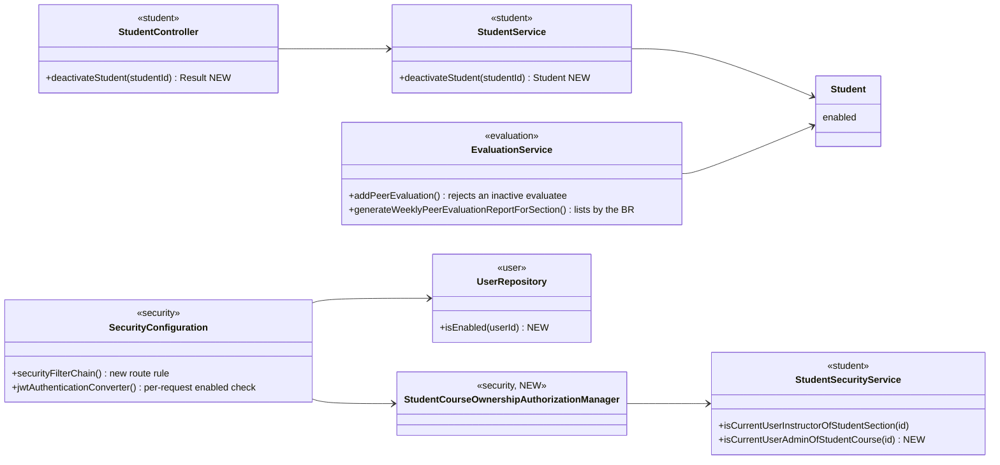
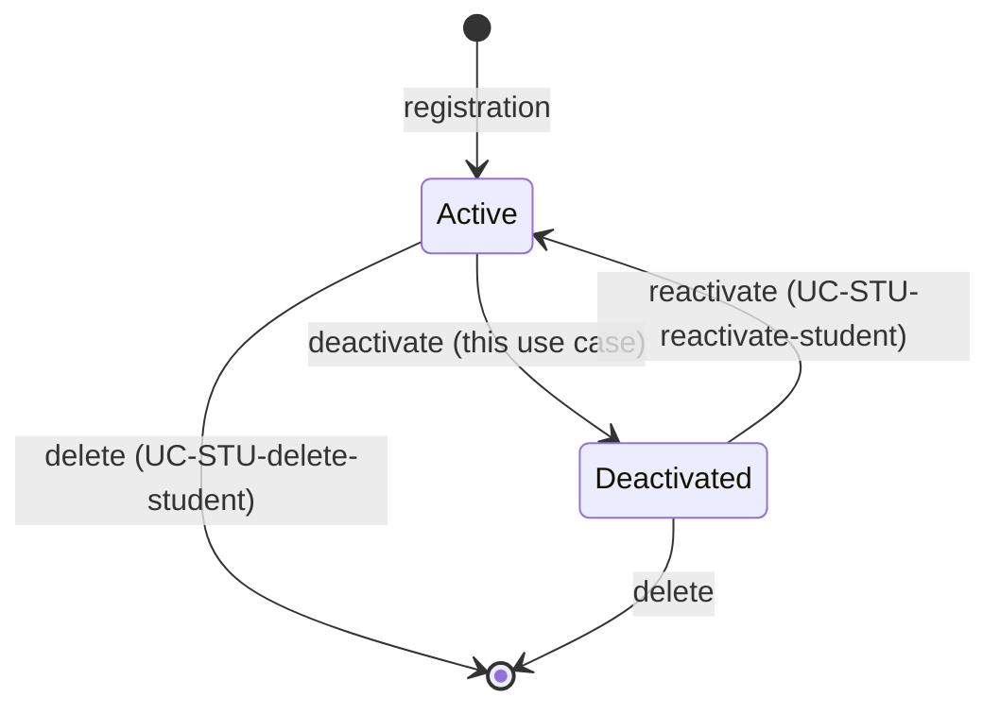

# Student (STU) Design

> Realizes: UC-STU-deactivate-student
> Depends on: FR-SEC-active-account, BR-student-lifecycle, BR-deactivated-student-not-evaluated, BR-submission-owed (already honored, unchanged), BR-section-scoped-access, BR-role-based-access
> See: [use cases](../requirements/use-cases.md#student), [SRS security requirements](../requirements/software-requirements-specification.md#security-and-authorization-requirements), [architectural-design.md](architectural-design.md#shared-foundation-components) (foundation component view), [Authorization](architectural-design.md#authorization)
> Designed against `main` at `59f0267` (2026-11-05). Design-as-built: the only path today is the generic `PUT /students/{id}` `enabled` flag.

## Overview

Deactivation turns a student's `enabled` flag off so she can no longer use the system while her record and submitted work stay. The flag already exists and is already checked at login. This design adds what the use case needs and the code lacks: a confirmed, dedicated action; an authorization rule that admits the course admin as well as the course section's instructor; a per-request check, so a student who is already logged in loses access at once; and the consequences for peer evaluations (teammates cannot evaluate her, and the section report lists her only for weeks she received evaluations). It extends the `student`, `security`, `user` and `evaluation` slices in the REST API container ([foundation components](architectural-design.md#shared-foundation-components)); no new bounded context and no schema change.

## Components & classes



| Component | Status | File |
|---|---|---|
| `Student.enabled` (via `PeerEvaluationUser`) | reused, no schema change | [`user/PeerEvaluationUser.java`](../../backend/src/main/java/team/projectpulse/user/PeerEvaluationUser.java) |
| `deactivateStudent` | new | [`student/StudentController.java`](../../backend/src/main/java/team/projectpulse/student/StudentController.java), [`student/StudentService.java`](../../backend/src/main/java/team/projectpulse/student/StudentService.java) |
| `isCurrentUserAdminOfStudentCourse`, `StudentCourseOwnershipAuthorizationManager` | new, thin wrapper | [`student/StudentSecurityService.java`](../../backend/src/main/java/team/projectpulse/student/StudentSecurityService.java), `security/authorizationmanagers/` |
| route rule, per-request enabled check | new | [`security/SecurityConfiguration.java`](../../backend/src/main/java/team/projectpulse/security/SecurityConfiguration.java), [`user/UserRepository.java`](../../backend/src/main/java/team/projectpulse/user/UserRepository.java) |
| inactive-evaluatee rejection, report rule | changed | [`evaluation/EvaluationService.java`](../../backend/src/main/java/team/projectpulse/evaluation/EvaluationService.java) |
| Deactivate button, confirm dialog; Status switch only while deactivated | changed | [`pages/students/EditStudentForm.vue`](../../frontend/src/pages/students/EditStudentForm.vue), `apis/student/` |
| teammate list filters `enabled` | changed, one line | [`pages/evaluations/SubmitTeamsEvaluations.vue`](../../frontend/src/pages/evaluations/SubmitTeamsEvaluations.vue) |
| `SubmissionStatusService` | unchanged, already honors BR-submission-owed | [`notification/SubmissionStatusService.java`](../../backend/src/main/java/team/projectpulse/notification/SubmissionStatusService.java) |
| `MyUserPrincipal.isEnabled` (login refusal) | reused | [`user/MyUserPrincipal.java`](../../backend/src/main/java/team/projectpulse/user/MyUserPrincipal.java) |

## Sequence

### UC-STU-deactivate-student, main success scenario (steps 1 to 7)

```mermaid
sequenceDiagram
    actor A as Course admin / instructor
    participant V as Students.vue / EditStudentForm.vue
    participant G as Route guard
    participant C as StudentController
    participant S as StudentService
    A->>V: 1-3. open student, click Deactivate
    V->>A: 4. confirm dialog (consequences, warning)
    A->>V: 5. Confirm (5a: Cancel sends nothing)
    V->>G: POST /students/{id}/deactivation
    G->>G: anyOf(instructor of her course section, admin of her course)
    G-->>V: 403 if neither (6b; an id that names nothing is also 403)
    G->>C: allowed
    C->>S: deactivateStudent(id)
    S->>S: findById (404, 6c); enabled=false, no change if already false (6a)
    C-->>V: Result(student, enabled=false)
    V->>A: 6. success message, reload list
```

### Extension 6d, the logged-in student

```mermaid
sequenceDiagram
    participant B as Browser (token issued before deactivation)
    participant F as Bearer token filter
    participant J as JwtAuthenticationConverter
    participant U as UserRepository
    B->>F: any request with a still-valid JWT
    F->>J: convert(jwt)
    J->>U: isEnabled(userId claim)
    U-->>J: false
    J-->>F: DisabledException
    F-->>B: 401 (existing AccountStatusException handler); the SPA clears the token and shows login
```

### Extension 6e and UC-EVA-submit-evaluation 1d, evaluation consequences

```mermaid
sequenceDiagram
    participant T as Teammate (SubmitTeamsEvaluations.vue)
    participant E as EvaluationService
    participant I as Instructor (SectionsEvaluations.vue)
    T->>T: teammate list omits deactivated students
    T->>E: POST /evaluations (evaluatee deactivated, stale form)
    E-->>T: rejected, nothing saved (1d)
    I->>E: report for week W
    E->>E: list a student if enabled OR she received evaluations in W
    E-->>I: weeks before deactivation keep her; later weeks omit her
```

### Lifecycle



## API contract

| Endpoint or job | Caller (who may) | Request | Success | Errors, by extension |
|---|---|---|---|---|
| `POST /api/v1/students/{studentId}/deactivation` | course admin of the student's course, or instructor assigned to her course section | none | `Result` with the student, `enabled=false`; the same success when she was already deactivated (6a) | 6b, and an id that names nothing: `403` at the route. 6c (a race only): `404` |
| any authenticated route | any role | the token | unchanged for an enabled account | 6d: `401` for a deactivated account, through the existing `AccountStatusException` handler |
| `POST /api/v1/evaluations` (changed) | student | unchanged | unchanged | 1d: rejected through the existing peer-evaluation illegal-argument error, as that use case's other extensions are |
| `PUT /api/v1/evaluations/{evaluationId}` | student | unchanged | unchanged | none new |
| `GET /api/v1/evaluations/sections/{sectionId}/week/{week}` (changed) | instructor assigned to the course section | unchanged | omits a deactivated student for a week in which she received no evaluations | none new |

## Key decisions

1. **A dedicated sub-resource route, not the `enabled` field on `PUT /students/{id}`.** Rejected: keep `PUT`, because the use case needs a confirmed, deliberate action and `PUT` is a whole-form save. Also rejected: `PATCH …/enabled` with a boolean, which would serve this use case and its sibling but blurs "UC-X passes"; reactivation can later be `DELETE …/deactivation`.
2. **Idempotent when already deactivated (6a).** Rejected: an error, because two actors clicking at once should not see a failure for a goal already met.
3. **Confirmation lives in the UI only.** Rejected: a server-side confirm token, which adds state for no gain because the action is reversible.
4. **The course-admin check is a new `anyOf` branch, not a widening of `isCurrentUserInstructorOfStudentSection`.** That method also guards the private-comments route, which is deliberately instructor-only. Today the route admits only the student herself or an instructor of her course section, so a course admin not assigned to the section is refused although BR-student-lifecycle admits her.
5. **Per-request enabled check, one primary-key lookup, for every role.** The JWT lives two hours and nothing rechecks `enabled`, so without this a deactivated student works until it expires, which FR-SEC-active-account forbids. Rejected: a shorter token lifetime and a cached flag (both leave a window the requirement forbids), and a revocation list (adds server state to a stateless design, KD-self-issued-jwt). Cost: one indexed lookup per authenticated request. It also closes the gap for deactivated instructors; UC-INS-deactivate-instructor is not changed here. This ships as the first, separate commit of the build pull request.
6. **The report rule is derived from data, not a stored date.** `addPeerEvaluation` refuses an inactive evaluatee, so after deactivation she receives nothing; the report lists a student if she is enabled or received evaluations that week, reusing `EvaluationService.findEvaluateeIdsByEvaluator` (flatten its values). Rejected: a `deactivated_at` column (reactivation clears it and loses history) and an interval table (couples this use case to its sibling and adds a migration). Accepted consequence: evaluations for the last week before deactivation that teammates had not yet submitted are lost, and an earlier week in which nobody evaluated her also drops out (she would have shown 0.0 there).
7. **Reject at the server, filter in the form.** The server rule is authoritative (BR-deactivated-student-not-evaluated); the form filter avoids a failing row in the normal case, and a stale form gets the 1d rejection. `GET /students/teams/{teamId}` has no other caller. Evaluations are saved one evaluatee at a time, so a teammate deactivated mid-submit can leave a partial set; this is harmless because BR-submission-owed asks only for active teammates.
8. **`PUT /students/{id}` stays unchanged for now.** The form shows the Deactivate button for an active student and the Status switch only while she is deactivated, as a temporary reactivation path. Rejected: stop honoring `enabled` on `PUT` now, because reactivation would lose its only path until UC-STU-reactivate-student is built; that use case's Associated Information records that it removes both.
9. **Data is retained.** Only `enabled` flips; team membership, activities and evaluations are untouched (BR-student-lifecycle).

## Data model

No delta. `enabled` already exists on `PeerEvaluationUser` ([Business Domain Model](../requirements/software-requirements-specification.md#business-domain-model)). No Flyway migration and no seed change.

## Reuse & cross-cutting

- Authorization: the `*SecurityService` plus thin-manager pattern and `anyOf` composition, as `UC-NOT-remind-non-submitters` does ([Authorization](architectural-design.md#authorization)).
- `AccountStatusException` to `401`, already in `ExceptionHandlerAdvice`.
- `EvaluationService.findEvaluateeIdsByEvaluator`, for "received evaluations that week".
- `SubmissionStatusService`, unchanged: it already excludes deactivated students (BR-submission-owed).

## Tests

| Use case, flow | Level | Asserts |
|---|---|---|
| UC-STU-deactivate-student, main (1 to 7) | unit, `StudentServiceTest` | `enabled` becomes false; other fields untouched |
| main | integration, `StudentIntegrationTest` | an instructor of her course section gets `200` and she reads back as disabled |
| main, course admin | integration | an owning course admin not assigned to the course section gets `200`; an admin of another course gets `403` |
| 5a cancel | Cypress, API stubbed | no request is sent; the student stays enabled |
| 6a already deactivated | unit and integration | `200`, nothing changes |
| 6b not permitted | integration | an unassigned plain instructor gets `403`; a student, herself included, gets `403` |
| 6c not found | unit and integration | the service throws not-found; an id that names nothing returns `403` at the route |
| 6d logged in | integration | a token issued before deactivation gets `401` on the next request; an enabled user's requests are unaffected |
| 6d shared check | integration | a deactivated instructor's token is also refused |
| postcondition, no access | integration | login of a deactivated student is refused |
| postcondition, retention | integration | her activities and evaluations remain, and she is absent from `/submission-status` |
| 6e, UC-EVA-submit-evaluation 1d | unit and integration, `EvaluationServiceTest`, `EvaluationIntegrationTest` | adding an evaluation of a deactivated evaluatee is rejected and no row is saved |
| 6e report, before | integration | a week before deactivation, in which she received evaluations, lists her with her data |
| 6e report, after | integration | a week after deactivation no longer lists her |
| 6e report, unaffected | unit | an enabled student with no evaluations still appears with 0.0, as today |
| 6e form | Cypress, API stubbed | the teammate list omits the deactivated student |

## Open questions / risks

- The per-request check adds one indexed lookup to every authenticated request. The build pull request should confirm the existing performance scenarios still hold.
- The 401 message for a deactivated account is the existing "User account is abnormal.", which tells the student nothing useful. Left as is; a clearer message is a separate change.
- A teammate deactivated mid-submit can leave a partial evaluation set (decision 7).
- "Deactivated" has no glossary entry (OI-65).
